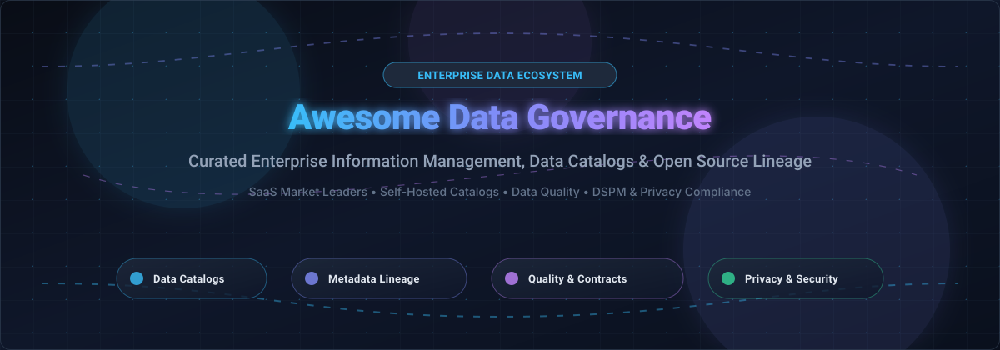

<div align="center">



# 🛡️ Awesome Enterprise Data Governance & Information Management 📊

**Curated Landscape of Enterprise SaaS Platforms & Open-Source Projects for Data Catalogs, Lineage, Metadata, Quality, & AI Trust Governance**

[](https://github.com/ishandutta2007/Awesome-Awesome-Awesome)<a href="https://discord.gg/jc4xtF58Ve"></a>
[](https://github.com/ishandutta2007/Awesome-Enterprise-Data-Governance-Information-Management/stargazers)
[](https://github.com/ishandutta2007/Awesome-Enterprise-Data-Governance-Information-Management/network/members)
[](https://github.com/ishandutta2007/Awesome-Enterprise-Data-Governance-Information-Management/blob/main/CONTRIBUTING.md)
[](https://opensource.org/licenses/MIT)
<a href="https://github.com/ishandutta2007"></a>

*Empowering Chief Data Officers (CDOs), data architects, platform engineers, and governance teams with discoverable, high-trust data foundations for cloud & enterprise AI initiatives.*

---

</div>

## 📑 Table of Contents
- [🌐 Sector Overview & Market Dynamics](#-sector-overview--market-dynamics)
- [💼 Enterprise SaaS Platforms](#-enterprise-saas-platforms)
- [🔓 Open-Source GitHub Projects](#-open-source-github-projects)
- [🤝 How to Contribute](#-how-to-contribute)
- [💖 Support](#-support)
- [⭐ Star History](#-star-history)
- [⚠️ Disclaimer](#️-disclaimer)

---

## 🌐 Sector Overview & Market Dynamics

The global enterprise data governance and information management market is estimated at **$4.6B – $5.2B in 2025/2026** and is accelerating at a **~16–22% CAGR**. Key market drivers include stringent global data protection regulations (GDPR, EU AI Act, CCPA/CPRA, DORA), enterprise cloud migrations, and the urgent imperative to prepare verified metadata graphs for generative AI and agentic systems. 

The sector's competitive structure is **moderately concentrated to medium fragmented**:
- **Enterprise Hyperscalers & Legacy Titans**: Cloud giants like **Microsoft** (Purview) and enterprise integration anchors like **Informatica** (IDMC) command pervasive cross-enterprise contracts.
- **Dedicated Pure-Play Category Leaders**: Specialized standalone champions like **Collibra**, **Alation**, and **Securiti** capture deep metadata stewardship, data quality, data access security, and AI guardrail workloads.
- **Emerging Open Standards**: Open metadata protocols (OpenLineage, OpenMetadata, DataHub) ensure the sector avoids single-vendor lock-in, enabling organizations to balance SaaS convenience with self-hosted sovereignty.

---

## 💼 Enterprise SaaS Platforms

> Curated list of enterprise-grade commercial platforms, sorted by **company valuation / market capitalization** (descending).

| Product | Valuation / Revenue | Description | Pricing (Starting) | Free Tier / Trial Limits |
|---|---|---|---|---|
| **[Microsoft Purview](https://www.microsoft.com/en-us/security/business/microsoft-purview)** | ~$3.89 Trillion (Market Cap) | Integrated data governance and compliance suite with **Data Map** (automated scanning, classification, and lineage) and **Unified Catalog** (governance domains, data products, and critical data elements). | Pay-as-you-go starting at ~$0.0165/governed asset/day (~$0.50/asset/month); Data Map scanning included free without Unified Catalog governance | **Free tier**: Up to 1,000 annotated assets lifetime (90-day inactivity purge); **Free trial**: 90-day trial with 25 Microsoft Purview Suite licenses for E3 customers |
| **[Informatica Cloud Data Governance](https://www.informatica.com/)** | ~$7.64 Billion (Market Cap) | Enterprise data governance and catalog within the IDMC platform. Utilizes consumption-based IPU (Informatica Processing Unit) credit pooling across cataloging, metadata scanning, and policy enforcement. | Starting floor at ~$131,760/year (12-month contract for 120 IPUs/month on AWS Marketplace, ~$91.50/IPU/month) | **No direct free tier** for CDGC module; **Free trial**: 30-day trial offered on companion IDMC modules (Cloud Data Integration & Data Quality) |
| **[Collibra](https://www.collibra.com/)** | ~$5.25 Billion (Valuation) | **The enterprise standard for governed data foundations.** Centralizes policies, automates workflows, and creates a single source of truth for business terminology. Features AI-driven stewardship, embedded Slack/Teams collaboration, and Data Helpdesk issue tracking. | Starting floor at ~$170,000/year (12-month base enterprise subscription on AWS Marketplace) | **No free tier**; **Free trial**: 20-day trial for Collibra Data Quality & Observability module only, guided interactive tours available on site |
| **[Securiti](https://securiti.ai/)** | ~$1.725 Billion (Valuation / Acquisition) | Unified Data Command Center for data security, privacy, governance, and AI safety. Features contextual AI firewalling, DSPM, and automated compliance. Acquired by Veeam Software in 2025. | Pro plan starting at $299/month ($3,050/year billed annually); Business plan starting at $599/month ($6,110/year billed annually) | **Free tier**: Permanent free plan for AI Security / AI Firewall with 1,000 requests/month; **Free trial**: 7-day Pro trial for SecuritiGPT (50 chats/day, 4 tool uses/day) |
| **[Alation](https://www.alation.com/)** | ~$1.70 Billion (Valuation) | **Pioneer of the data catalog market with an Agentic Platform for AI.** Agents automate documentation, resolve incomplete metadata, and apply governance policies. AI Agent SDK with Anthropic MCP support lets organizations build custom agents on top of Alation's metadata graph. 40% of the Fortune 100 are customers. | Starting floor at ~$60,000/year (12-month base package on AWS Marketplace; full enterprise deployments typically scale $100,000+/year) | **No free tier**; **Free trial**: Custom sales-scoped evaluation / Proof of Concept (PoC) pilot under formal trial agreements; interactive tours available online |
| **[BigID](https://bigid.com/)** | ~$1.00 Billion (Valuation) | Data intelligence platform for discovery, classification, and privacy compliance across 100+ sources. Advanced discovery layer mapping structured, unstructured, and streaming data for privacy frameworks and DSPM. | C4 Discovery Foundation Package starts at $525,000 (3-year contract for up to 100 data sources); optional Purview connector at $35,000/year | **No free tier**; **Free trial**: Free Data Risk Assessment (specialist-led scan of targeted AWS/M365 environment) or customized enterprise PoC pilot |
| **[Ataccama ONE](https://www.ataccama.com/)** | ~$550 Million (Valuation) | Unified platform for the data trust lifecycle spanning cataloging, data quality, and MDM. Unlimited read-only consumer seats across all license levels; cost is calculated across authoring named users, managed data objects, and active DQ rules. | Starting floor ranges between ~$118,000 – $133,000/year for entry enterprise deployments (placeholder $1.00 unit on AWS Marketplace requires custom contract) | **No free tier**; **Free trial**: Guided Proof of Concept / sandbox evaluation via sales, plus free access to Ataccama Academy sandbox training labs |
| **[Privacera (Trust3 AI)](https://privacera.com/)** | ~$250M – $500M (Valuation) | **Agentic platform for data and AI governance.** Positions itself as the "Trust layer" bridging traditional data governance and AI policy enforcement. Trust agents govern data and AI with enterprise-grade security and unified Apache Ranger-compatible policies. | PrivaceraCloud Starter Pack starts at ~$100,000/year (12-month contract on AWS Marketplace) | **No free tier**; **Free trial**: 30-day free trial available for PrivaceraCloud on AWS Marketplace (software license included; user covers AWS infrastructure) |

---

## 🔓 Open-Source GitHub Projects

> Active, production-ready open-source platforms and tools for metadata management, data discovery, quality assertions, access control, and pipeline lineage. Sorted by **GitHub Stars_Count** (descending).

| Project | GitHub_Stars | Primary Focus | Description |
|---|---|---|---|
| **[OpenMetadata](https://github.com/open-metadata/OpenMetadata)** | [](https://github.com/open-metadata/OpenMetadata/stargazers) | Unified Metadata & Contracts | **Unified open-source metadata platform with column-level lineage and data contracts.** Centralized metadata repository with automated data discovery, end-to-end lineage, team collaboration workflows, sensitive PII auto-tagging, and native data quality tests. Built on Apache 2.0. |
| **[DataHub](https://github.com/datahub-project/datahub)** | [](https://github.com/datahub-project/datahub/stargazers) | Modern Extensible Metadata | **LinkedIn's modern, real-time metadata platform.** API-first architecture powered by GraphQL and Kafka streaming ingestion. Provides full-text search, column-level graph lineage, impact analysis, access management integration, and robust support for modern data stack connectors. |
| **[Great Expectations](https://github.com/great-expectations/great_expectations)** | [](https://github.com/great-expectations/great_expectations/stargazers) | Data Quality & Testing | **The leading open-source standard for data quality validation and pipeline testing.** Enables data engineers to write expressive assertions (expectations), automate test suites during ETL execution, and render auto-generated human-readable data documentation to enforce governance policies. |
| **[Amundsen](https://github.com/amundsen-io/amundsen)** | [](https://github.com/amundsen-io/amundsen/stargazers) | Data Discovery & Catalog | **Data discovery engine created by Lyft.** Indexes data assets (tables, dashboards, streams, users) using graph engines (Neo4j / Neptune) and Elasticsearch to power PageRank-style search, rich data curation, frequent-user insights, and automated schema descriptions. |
| **[OpenLineage](https://github.com/OpenLineage/OpenLineage)** | [](https://github.com/OpenLineage/OpenLineage/stargazers) | Open Lineage Standard | **Open standard for comprehensive data lineage collection and analysis.** Defines an extensible JSON specification to capture operational metadata and job state directly from Spark, Airflow, Flink, dbt, and Great Expectations as pipelines run, avoiding reverse-engineering logs. |
| **[Soda Core](https://github.com/sodadata/soda-core)** | [](https://github.com/sodadata/soda-core/stargazers) | Data Reliability & Profiling | **Free, open-source command-line tool and Python library for data reliability testing.** Translates human-readable YAML checks (SodaCL) into SQL queries to uncover anomalies, track data drifts, profile schema shifts, and guard enterprise catalogs against silent data corruption. |
| **[Marquez](https://github.com/MarquezProject/marquez)** | [](https://github.com/MarquezProject/marquez/stargazers) | Metadata & Lineage Engine | **Open-source metadata service developed by WeWork and reference implementation of OpenLineage.** Collects, aggregates, and visualizes dataset lifecycle provenance, job run states, schema versions, and centralized health metrics in an intuitive UI. |
| **[Apache Atlas](https://github.com/apache/atlas)** | [](https://github.com/apache/atlas/stargazers) | Hadoop & Enterprise Metadata | **The longest-standing open-source metadata and governance framework.** Provides scalable metadata exchange, data classification, centralized auditing, and business taxonomy mapping. Tightly integrated with Apache Ranger for dynamic tag-based authorization across distributed clusters. |
| **[Diffgram](https://github.com/diffgram/diffgram)** | [](https://github.com/diffgram/diffgram/stargazers) | AI Data Governance & Training | **Open-source training data management and AI dataset governance platform.** Provides end-to-end dataset versioning, schema annotation workflows, ground-truth auditing, and governance catalogs tailored specifically for computer vision and multimodal AI systems. |
| **[Apache Ranger](https://github.com/apache/ranger)** | [](https://github.com/apache/ranger/stargazers) | Security & Access Governance | **Comprehensive open-source security framework to monitor and manage data security policies.** Delivers centralized administration for authentication, fine-grained access authorization (RBAC/ABAC), row-level filtering, and dynamic column masking across enterprise data platforms. |
| **[Magda](https://github.com/magda-io/magda)** | [](https://github.com/magda-io/magda/stargazers) | Federated Data Catalog | **Federated, cloud-native open-source data catalog system developed by Australia's CSIRO Data61.** Built on Kubernetes, Magda crawls, indexes, and normalizes metadata across decentralized internal repositories and public open data portals. |
| **[OpenDLP](https://github.com/ezarko/opendlp)** | [](https://github.com/ezarko/opendlp/stargazers) | Data Loss Prevention Scanner | **Open-source data loss prevention scanner** for discovering and tagging sensitive data at rest (credit cards, SSNs, PII, credentials) across centralized databases (MySQL, MSSQL) and enterprise network shares. |

---

## 🤝 How to Contribute

Contributions are warmly welcomed! Help keep this enterprise data governance resource comprehensive, current, and objective:

1. **Fork the repository** to your GitHub profile.
2. **Create a branch** for your feature or update:
   ```bash
   git checkout -b feature/add-new-governance-tool
   ```
3. **Add or modify entries** in `README.md` maintaining standard tabular structure:
   - Provide clean markdown links to the project/product.
   - For SaaS products: supply specific starting tier prices, clear trial/free terms, and company valuation/revenue context.
   - For open-source tools: supply an official GitHub Stars_Badge (`style=social&color=white`) linking to its stargazers page.
4. **Commit your changes**:
   ```bash
   git commit -m "Add [Tool Name]: brief rationale"
   ```
5. **Open a Pull Request** with a concise description of why the tool belongs in this curated collection.

---

## 💖 Support

If you find this curated collection helpful for navigating enterprise data governance, data cataloging, or metadata strategy, please consider showing your support:

- ⭐ **Star this repository** to help others discover it across GitHub.
- 🍴 **Fork and share** with your data engineering, governance, or platform teams.
- ☕ **Sponsor or buy a coffee**: Support ongoing curation and open-source intelligence on the [Sponsor Dashboard](https://github.com/sponsors/ishandutta2007).

---

## ⭐ Star History

[](https://www.star-history.com/#ishandutta2007/Awesome-Enterprise-Data-Governance-Information-Management&type=date&legend=top-left)

---

## ⚠️ Disclaimer

- This repository is a **community-curated index** created solely for research, architectural planning, and educational purposes. Inclusion does not constitute an endorsement.
- Enterprise data governance, cataloging, and access control platforms handle mission-critical metadata, classification taxonomies, and access permissions. Enforce strict least-privilege policies, test classification pipelines in staging environments, and verify compliance with regional statutes before production deployment.
- **Commercial pricing transparency**: Enterprise SaaS costs vary by contract duration, deployment size, and consumption tiers. Quotes and pricing floors referenced represent publicly reported baselines, cloud marketplace filings, and third-party SaaS procurement benchmarks. Verify exact terms with platform vendors.

---

<div align="center">

**Curated with care for Chief Data Officers, Data Governance Stewards, and Platform Engineering Teams worldwide.**

</div>
